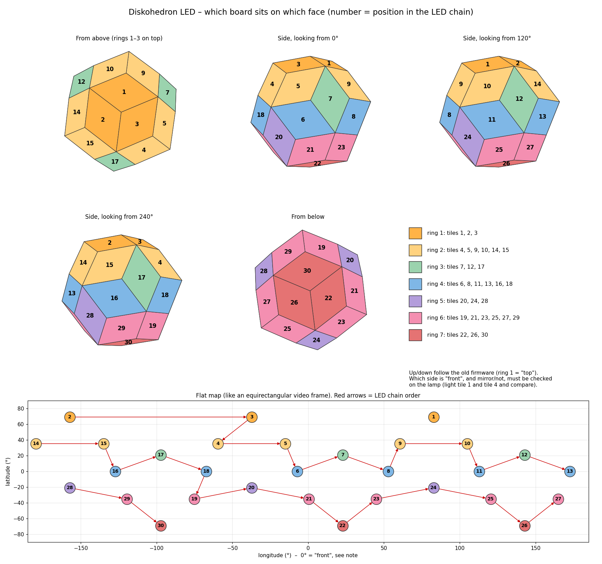

# Diskohedron – ESP32 version

The ESP32 replaces the Arduino + Raspberry Pi + Node server. It drives the 30
boards directly and serves the web UI from its own WiFi hotspot.

```
esp32/
├── diskohedron/        Arduino sketch (firmware)
│   ├── config.h        pins, WiFi names/passwords
│   ├── LedChain.*      driver for the STP04 chain (replaces ShiftPWM)
│   ├── Effects.*       lamp modes
│   ├── State.*         modes, parameters, presets (saved in flash)
│   ├── Net.*           hotspot, captive portal, web server, WebSocket, OTA
│   └── web_assets.h    generated from web/ – do not edit
├── web/                web UI (vanilla HTML/JS/CSS, no libraries)
├── docs/
│   ├── tile_layout.png which board sits on which face
│   └── WIRING.pdf      WIRING.md as PDF
└── tools/
    ├── embed_web.py    web/ -> diskohedron/web_assets.h
    ├── mock_lamp.py    fake lamp for UI work without hardware
    ├── md2pdf.py       markdown + mermaid -> PDF (docs/WIRING.pdf)
    ├── artnet/         Resolume / TouchDesigner input (own README)
    └── sphere/         geometry, video converter, ripple preview (own README)
```

## Wiring (to JP1 on the first board)

Full wiring with diagrams (ESP32, power feeds, extra ground wires, board
chain): **[WIRING.md](WIRING.md)**.

| ESP32   | ESP32-C3 | JP1 pin | signal          |
|---------|----------|---------|-----------------|
| GPIO 18 | GPIO 6   | 3       | EXTCLK          |
| GPIO 23 | GPIO 7   | 4       | EXTDATA         |
| GPIO 4  | GPIO 10  | 5       | EXTOE (= latch) |
| GND     | GND      | 2       | GND             |

The ESP32-C3 works too (e.g. a C3 SuperMini). The pins switch automatically
when you compile for it.

Power the ESP32 from its own small 24 V → 5 V buck module, with GND shared with
the lamp. The ESP32 is 3.3 V logic, so the old 5 V-into-`4D` overvoltage is gone.
Pins are set in `config.h`.

## Build & flash

Libraries (Arduino library manager): **ArduinoJson**, **ESP Async WebServer**
and **Async TCP** (both by ESP32Async). Board package: esp32 by Espressif (3.x).

Quickest: `tools/flash.sh` does everything below (web → build → upload). It uses
USB if a board is plugged in, otherwise WiFi (`diskoledron.local`). Also
`tools/flash.sh usb`, `tools/flash.sh ota [host]` and `tools/flash.sh build`; prefix
`CHIP=esp32` for the classic ESP32 (default is the C3).

By hand:

```sh
cd software/esp32
python3 tools/embed_web.py              # after every change in web/
cd diskohedron
arduino-cli compile --fqbn esp32:esp32:esp32:PartitionScheme=min_spiffs .
arduino-cli upload  --fqbn esp32:esp32:esp32:PartitionScheme=min_spiffs -p /dev/cu.usbserial-XXXX .
```

In the Arduino IDE: board "ESP32 Dev Module", partition scheme
"Minimal SPIFFS (1.9MB APP with OTA)".

For an **ESP32-C3**, use `esp32:esp32:esp32c3:PartitionScheme=min_spiffs`
(IDE: "ESP32C3 Dev Module"). Its USB port shows up as `/dev/cu.usbmodem…`.
On a SuperMini, if you want serial output, enable "USB CDC On Boot".

**From the web page:** open "Firmware" at the bottom of the page, pick `diskohedron.ino.bin`
(`tools/flash.sh build` prints its path; in the Arduino IDE use Sketch → Export Compiled Binary,
and take the `.ino.bin` file, not `.merged.bin`), enter the update password (`OTA_PASSWORD`) and
press Install. The lamp checks the file (ESP32 firmware for the right chip), writes it to the
second app slot, and restarts only if all of it arrived. Otherwise it keeps the old firmware.
The section also shows the running version: raise `FIRMWARE_VERSION` in `config.h` for each release.

After the first USB flash, updates also work over WiFi (OTA, password in
`config.h`): the lamp shows up as a network port `diskoledron`.

## Using it

1. Join WiFi **diskoledron** (password `diskodisko`).
2. The phone opens the control page by itself (captive portal). If not, go
   to `http://192.168.4.1`.

**Home WiFi:** at the bottom of the page, open "Home WiFi", pick or type your
network, enter the password and press Connect. The lamp is then reachable from
any device on that network at `http://diskoledron.local`, or at the IP shown
there. Its own hotspot stays on as a fallback.
- The setting is stored on the lamp and survives power cuts.
- If the network is unreachable (router off, wrong password), the lamp tries
  again every minute.
- "forget network" goes back to hotspot only.
- `STA_SSID` / `STA_PASS` in `config.h` are only a default until something is
  saved in the page.

**Calibrate** (bottom of the page, needs a luxmeter): measure each LED per colour.
In a dark room, hold the meter at the same spot and distance on every face. Tap a board, and only
that LED lights at full power, red first. Type the reading and press Enter; it switches to
green, blue and white, then moves on to the next board.
- **Even out boards:** every LED is dimmed to the weakest board of its colour. A board far
  below the others (< 70 % of the median) is ignored, so one bad LED doesn't dim the whole lamp.
- **Balance colours:** red, green and blue are dimmed until equal values give a neutral white.
  It uses the sRGB brightness ratio 21 : 72 : 7, from the median of the boards. Measuring one
  board is enough for this. White stays at full power.
- Both apply to every mode, presets, Art-Net and video streams, and can be switched off.
  The measurements are stored in `/calib.json`.
- Cheap luxmeters can be 10–30 % off for pure red or blue LED light. Evening out the boards per
  colour isn't affected by this; the colour balance is approximate.

Mode, parameters, presets, calibration and the WiFi setting survive a power cycle. Changes
are saved 3 s after the last edit.

## Modes

| Mode         | Was (old firmware)  | Parameters                               |
|--------------|---------------------|------------------------------------------|
| Off          | MODE_OFF            | –                                        |
| Flicker      | MODE_BWFLICKER      | intensity, interval                      |
| Colour noise | MODE_COLORNOISE     | max R/G/B/W, interval                    |
| Game of Life | MODE_GOL            | generation time, reseed interval         |
| Sweep        | MODE_BOOT           | intensity, speed (negative = upwards)    |
| Colour       | (new, UI had RGBW)  | R/G/B/W                                  |
| Ripples      | (new)               | drops/min, speed, ring width, colourfulness |
| Check        | (new)               | time per board, colours (checkboxes): boards 1-30 one at a time, preset "checklamp" |
| Manual       | (new)               | colour per board: tap boards (several at once) and set R/G/B/W; saved with presets |

Plus a global brightness (0–100 %). All values are 0–255 now; the old full
scale was 165.

## Geometry: which board is where



Each board sits on one rhombic face of the triacontahedron. Its **tile number
is its position in the LED chain** (tile 1 = the board the ESP32 is wired to).

The layout comes from the old firmware's face neighbour table
(`initNeighbours`) and its 7 horizontal rings (`ledrows36`). Matching them
against the real polyhedron gives exactly one layout, up to which way the lamp
faces and mirroring.
- **Top:** a 3-fold corner, with tiles 1, 2, 3 around it.
- **Bottom:** tiles 22, 26, 30.
- **The chain:** it circles the top, zigzags down through three identical 120°
  sectors (4–8, 9–13, 14–18), then does the same on the lower half.
- **One typo fixed:** the old table listed tile 5 as a neighbour of tile 17;
  it's tile 4. This only affected the Game of Life.

`software/zwart-order.png` belongs to the corner-light version (32 corners) and
does not apply here.

## Video on the lamp

`tools/sphere/video2lamp.py` wraps an image or video onto the 30 faces. Each
face averages the pixels that land on it. It needs `numpy`, `opencv-python`,
`matplotlib` and `websockets`.

```sh
cd software/esp32/tools/sphere
python3 video2lamp.py clip.mp4 --preview preview.gif                 # look at it first
python3 video2lamp.py clip.mp4 --stream ws://192.168.4.1/ws --loop   # play it live
python3 video2lamp.py clip.mp4 --out clip.disko                      # save the frames
```

**Projections (`--map`):**
- `polar` (default, for **square** videos): the centre of the frame is the
  top of the lamp and the edge of the inscribed circle is the bottom. The angle
  around the centre is the angle around the lamp.
- `equirect`: 2:1 panoramas and 360° videos.
- `cylinder`: wraps the frame around the lamp like a label.

**Useful options:**
- `--spin 20` turns the image 20 °/s around the lamp.
- `--azimuth` sets the front direction.
- `--saturation` (default 1.3) helps because 30 pixels look washed out.
- `--white` controls how much of the shared RGB goes to the W LED.

**Streaming:** each frame is one binary WebSocket message of 120 bytes (R, G,
B, W per tile, tile 1 first). While frames arrive the lamp shows them. One
second after the last frame it goes back to the selected mode. Global
brightness still applies.

**Calibrate once on the real lamp:**
```sh
python3 video2lamp.py --calibrate --stream ws://192.168.4.1/ws --loop
```
- Expected: red = front, green = 90° to the right, blue = back, white = left,
  dark top, yellow bottom.
- If the dark cap is at the bottom, the lamp is mounted the other way up from
  the old firmware's rings. Tell me and I'll add a flip option.
- If green is on the **left** of red (seen from outside), add `--mirror`.
- Use `--azimuth` to put "front" where you want it.

The `.disko` file is a 12-byte header (`DSKO`, version, tiles, fps×100,
frame count) followed by the frames. A minute at 25 fps is 176 KB.

## Smart home / scripts

The lamp has an HTTP JSON API: on/off, brightness, mode, colour, presets and every parameter,
via `POST /api/state` or plain URLs like `/api/state?on=toggle`. Details and Home Assistant
examples: **[API.md](API.md)**.

"Lamp on" in the web page (below brightness) is the same switch: off makes the lamp
dark but keeps the mode, so switching on again resumes it.

## Resolume / TouchDesigner

The lamp receives **Art-Net**: universe 0, channels 1–120 = tile 1–30 × RGBW,
and it answers ArtPoll as `diskoledron`. Setup, pixel maps and a TouchDesigner
script are in [tools/artnet/README.md](tools/artnet/README.md).

## Differences to the Arduino firmware

- **Timing in milliseconds.** The old animations advanced once per `loop()`,
  so their speed depended on CPU load. Speeds are now set in real units and
  may need tuning to match the old look.
- **LED refresh** is ~130 Hz with 8-bit brightness (was 60 Hz, 166 steps).
  The SPI peripheral sends the frames by DMA, so the CPU is free for WiFi.
- **Bugs fixed while porting:**
  - `if (state = STATE_PARAM)`
  - the alive-rule rotation lost a value
  - the seed never set red (`random(125)`)
  - an all-dead Game of Life now reseeds instead of staying dark
- **Adding a parameter or mode:** add it to `PARAMS`/`MODES` in `State.*` and
  implement it in `Effects.cpp`. The UI builds its controls from that table.

## Not tested on hardware yet

The firmware compiles cleanly and the UI was tested against `mock_lamp.py`.
On the first real run, check with 1–3 boards:
- channel order (R/G/B/W) and board order
- no flicker
- the CLK and LE signals on a scope
