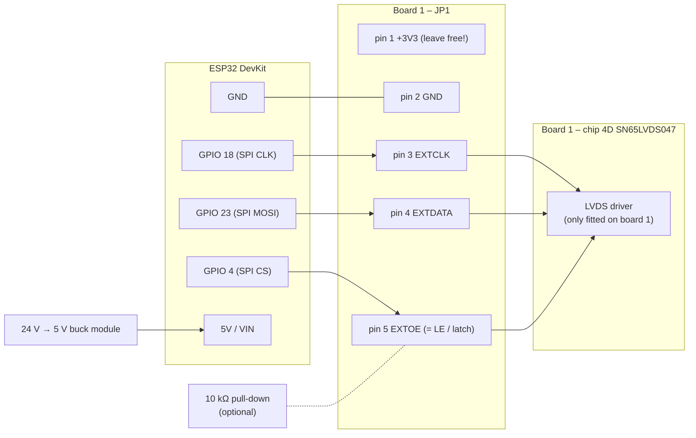
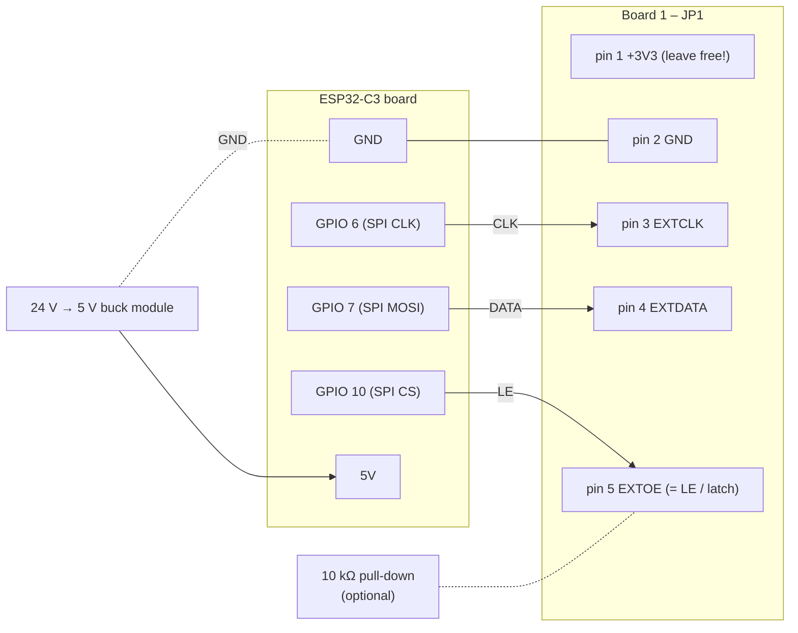
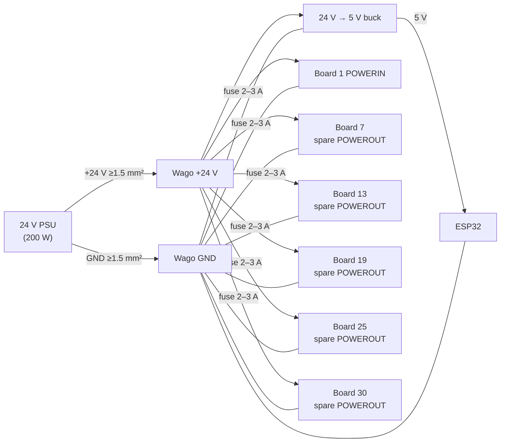
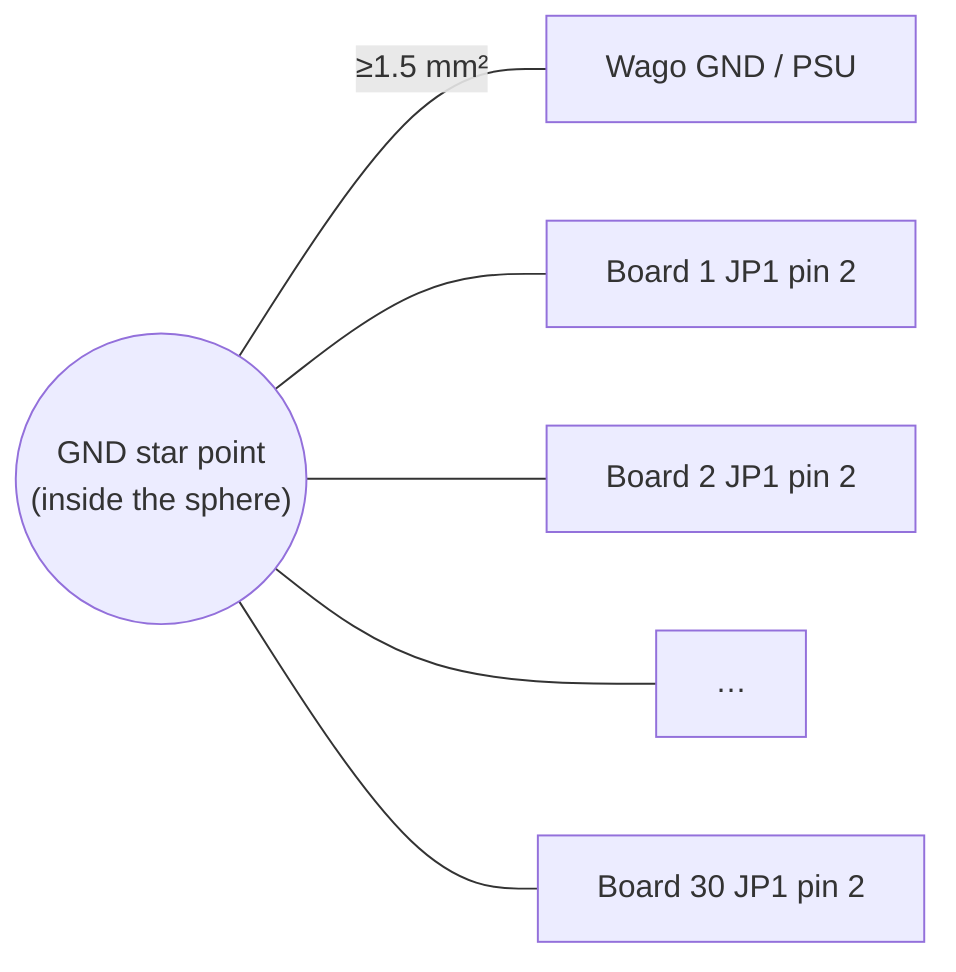
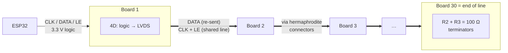

# Wiring – ESP32 version

Three parts: the ESP32 to board 1 (signals), the power distribution, and the
board chain.

## 1. ESP32 → board 1 (JP1)

JP1 is the 5-pin "external uC" header on the **first** board of the chain.
Its pins are through-hole, so you can solder wires directly.

| ESP32   | JP1 pin | Signal          | Note                                             |
|---------|---------|-----------------|--------------------------------------------------|
| GPIO 18 | 3       | EXTCLK          | SPI clock, 4 MHz                                 |
| GPIO 23 | 4       | EXTDATA         | SPI data                                         |
| GPIO 4  | 5       | EXTOE (LE)      | SPI chip-select = latch                          |
| GND     | 2       | GND             | short, solid wire                                |
| –       | 1       | +3V3            | **don't connect** the ESP32's own 3.3 V here     |

### ESP32-C3 variant (e.g. C3 SuperMini)

| ESP32-C3 | JP1 pin | Signal     |
|----------|---------|------------|
| GPIO 6   | 3       | EXTCLK     |
| GPIO 7   | 4       | EXTDATA    |
| GPIO 10  | 5       | EXTOE (LE) |
| GND      | 2       | GND        |
| –        | 1       | +3V3: don't connect |

The pins are set automatically in `config.h` when you compile for the C3.
Don't use GPIO 2/8/9 (boot strapping), 18/19 (USB) or 12–17 (flash) for this.
On the SuperMini the pins are printed as `6`, `7`, `10` next to the pads. Use
any `G` pad for GND.

- Keep these wires short (< 20 cm) and twist each signal wire with a GND wire if you can.
- **Optional:** a 10 kΩ resistor from JP1 pin 5 to pin 2. It keeps the latch quiet while the ESP32 boots, which reduces the random flash at power-on.
- Check pins 1 and 2 with a multimeter before soldering: pin 2 must beep against the big capacitor's GND pad.

## 2. Power

One PSU feeds everything through Wago blocks: the start of the chain, extra
feeds every ~6 boards, and the ESP32's buck module.

- **One PSU only.** All feeds go back to the same Wago blocks.
- Feed wires: ≥ 0.75 mm², or thinner with an inline 2–3 A fuse in +24 V.
- **Polarity differs between outlets:** POWEROUT-S is the reverse of L/R.
  Measure each feed connector before putting it into the Wagos.
- The board numbers above are an example. Use whichever boards have a free
  power outlet, about every 6th board.

### Extra ground wires (recommended)

So that one bad power contact can't push current through the LVDS chips:

0.25–0.5 mm² per board is enough.

## 3. Board chain

DATA is re-sent by every board. CLK and LE are **one shared line** across all
30 boards, carried on by the solder bridges.

| Part                     | Board 1    | Boards 2–29 | Last board |
|--------------------------|------------|-------------|------------|
| `4D` SN65LVDS047         | fitted     | **empty**   | **empty**  |
| R2 / R3 (100 Ω)          | empty      | empty       | **fitted** |
| CLK/LE solder bridges    | to the ONE outlet that continues the chain (same as DATA) | same | none |

The "last board" is wherever the CLK/LE line ends. There must be no branches,
otherwise every dead end needs its own terminator (see the debug PDF,
`pcb/diskohedron4w_revf_DEBUG.pdf`).
